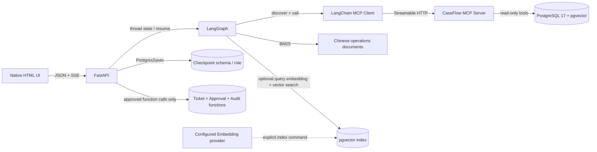

# CaseFlow Agent

CaseFlow is a local engineering demonstration for payment incident investigations. It combines a LangGraph investigation loop, PostgreSQL read-only tools, Chinese BM25 retrieval, optional pgvector hybrid search, MCP tool transport, durable threads, and a human-approved support-ticket action. It is not a production payment control plane.

## V1-C acceptance status

**Locally exercised on 2026-11-11** against the existing synthetic PostgreSQL databases. This is a loopback-bound engineering demo, not a production deployment.

Detailed evidence, including database preservation, tool traces, Live usage, and remaining limits, is in [V1-C final acceptance](docs/V1C_ACCEPTANCE_2026-11-11.md).

| Area | Verified result |
|---|---|
| Python and Compose | Existing `.venv`; dependency/import smoke, `pip check`, Ruff, and Compose config passed. |
| PostgreSQL and data | PostgreSQL 17.11 and pgvector 0.8.7 healthy. Both databases retained 49,600 attempts, 18 documents, 7 changes, and 4 incidents. Pre-migration custom-format backups were readable. |
| MCP and Agent | Standalone MCP discovered all three tools, validated schemas/errors/disconnects, and returned structured results. Thread investigations used the MCP client against the real test database. |
| Threads and approvals | Multi-turn thread state survived API/checkpointer restarts and remained isolated by thread. Reject, approve, duplicate and parallel decisions, hash tampering, orphan recovery, audit writes, and direct-write denial were exercised on `caseflow_test`; acceptance work orders were cleaned up. |
| Retrieval | BM25 fallback and BM25 + pgvector + RRF ran against 18 indexed deterministic 64D test vectors. `EXPLAIN` showed the matching HNSW expression index. Add/update/delete index synchronization passed. These hash vectors test plumbing only; semantic embedding quality was not evaluated. |
| Browser and SSE | UI investigation, report/evidence, approval decisions, refresh/reload, and SSE event replay after reconnect were exercised in a browser. |
| Regression | Exactly 8 pytest cases collected and passed. `scripts/mcp_smoke.py` and `scripts/v1c_smoke.py` passed. |
| Live model | One real investigation completed through the configured zero-price OpenRouter `nvidia/nemotron-3.5-super-vl:free` route: 3 model requests, 8,408 reported tokens, 23.3 s, $0. No fallback was configured. Citation ID/quote checks passed; semantic support for two hypotheses remains ungraded. |

No automatic LLM-created ticket proposal, authentication/authorization layer, production deployment controls, or real embedding provider evaluation is included. The UI prefills a reviewable draft and a human submits it.

## Architecture



The investigation loop is `decision → MCP tool execution → decision → evidence validation and synthesis`. MCP exposes only `query_payment_metrics`, `query_change_events`, and `search_knowledge`; it provides no arbitrary SQL or write tool. The Agent validates discovered names and input schemas against this allowlist. The MCP adapter opens a fresh Streamable HTTP session for each remote tool call; read-only transport errors get one retry and a configured timeout.

LangGraph checkpoints each thread with a `thread_id`. `history` stores the user's turns and concise assistant report summaries; each investigation also checkpoints its report and tool/model traces. `POST /api/v1/threads/{thread_id}/resume` resumes the saved graph from its latest checkpoint after an interrupted request. Checkpoint tables are stored in the `caseflow_checkpoint` schema through `CHECKPOINT_DATABASE_URL`, separate from the read-only business role. A separate checkpoint namespace stores thread registration, and another stores approval workflow state.

The approval graph stores a pending draft, calls LangGraph `interrupt()`, then waits for an API decision to resume with `Command(resume=...)`. The executor role has `EXECUTE` access to a few `SECURITY DEFINER` database functions only; it has no direct table DML. Those functions bind the approved payload to a database-computed SHA-256 hash, lock the approval row, deduplicate the same active or executed draft within a thread, create at most one ticket per approval, and record audit events in the same transaction. The existing `caseflow_app` remains read-only. Unapproved or changed drafts cannot reach ticket creation. The project has no authentication, so keep it bound to loopback for local demonstration.

The checkpointer uses a small psycopg connection pool. Its thread registry retries one transient PostgreSQL connection error, allowing a running API process to recover its durable thread state after a PostgreSQL restart.

BM25 always remains available. If a separate embedding provider is fully configured and the vector table has fresh vectors, retrieval combines BM25 and pgvector rankings with Reciprocal Rank Fusion (RRF), deduplicates stable evidence IDs, and labels the result `hybrid`; otherwise the result is labeled `bm25_only`. The acceptance smoke used a deterministic local hash-vector fixture to test database/index plumbing only; it is not a semantic embedding and is not used as evidence of retrieval quality. A content hash and model name key the stored embedding cache. The reranker is only a provider protocol.

SSE exposes `status`, `agent_step`, `tool_start`, `tool_result`, `evidence`, `approval_required`, `completed`, and `error`. The bounded event journal is process-local; thread history and latest report are durable and can be fetched again after reconnect or process restart, but old intermediate SSE events are not persisted.

## Components and interfaces

| Component | Entry point |
|---|---|
| FastAPI + UI | `GET /`, `GET /health`, `POST /api/v1/investigations` |
| Threads | `POST /api/v1/threads`, `GET /api/v1/threads/{thread_id}`, `POST /api/v1/threads/{thread_id}/messages`, `POST /api/v1/threads/{thread_id}/resume`, `GET /api/v1/threads/{thread_id}/events` |
| Ticket approvals | `POST/GET /api/v1/threads/{thread_id}/approvals`, `GET /api/v1/threads/{thread_id}/approvals/{approval_id}`, `POST /api/v1/threads/{thread_id}/approvals/{approval_id}/decision` with `{"decision":"approve"}` or `{"decision":"reject"}` |
| Standalone MCP | `caseflow-mcp`, Streamable HTTP at `/mcp`, health at `/health` |
| MCP smoke | `python scripts/mcp_smoke.py` (starts a local MCP subprocess; test DB only) |
| Checkpoint setup | `python scripts/setup_checkpoint_db.py`; use `--test` with `TEST_CHECKPOINT_DATABASE_URL` |
| Database migration | `.\scripts\apply_v1c_migration.ps1` (explicit; run only after reviewing/backup) |
| Embedding index | `python scripts/index_embeddings.py --confirm-embedding-api` |
| Retrieval evaluation | `python scripts/evaluate_retrieval.py --retriever bm25|vector|hybrid`; Vector/Hybrid also require `--confirm-embedding-api` |

The original `/api/v1/investigations` endpoint remains available for single-shot native tool use. Durable thread investigations use the MCP client. LangGraph's thread history is isolated by `thread_id`; FastAPI serializes concurrent messages on the same thread within one process.

## Windows setup

Use Python 3.13.2, Docker Desktop with WSL 2, PowerShell, and the existing project `.venv`. Do not overwrite an existing `.env`:

```powershell
if (-not (Test-Path .env)) { Copy-Item .env.example .env }
New-Item -ItemType Directory -Path .tmp -Force | Out-Null
$env:TEMP = (Resolve-Path .tmp).Path
$env:TMP = $env:TEMP
.\.venv\Scripts\python.exe -m pip install -e ".[dev]"
```

The Compose PostgreSQL service builds `Dockerfile.postgres`: pgvector 0.8.7 is compiled into the same `postgres:17-alpine` base used by the existing instance. This preserves PostgreSQL's Alpine/libc data-directory compatibility while retaining the existing `caseflow_pgdata` named volume. The V1-C acceptance backed up both databases before applying migrations, and verified the custom-format dumps were readable. Compose does not contain a volume deletion or reset command. **Do not use `docker compose down -v`.** The V1-C migration and checkpoint `setup()` are separate, explicit steps; neither runs at API startup.

For a fresh local setup, review `.env.example`, change the development-only passwords, and then start services:

```powershell
docker compose up -d postgres
.\.venv\Scripts\python.exe scripts\seed_database.py
.\scripts\apply_v1c_migration.ps1
.\.venv\Scripts\python.exe scripts\setup_checkpoint_db.py
docker compose up -d mcp api
```

To migrate the isolated test database separately, run `.\scripts\apply_v1c_migration.ps1 -Database caseflow_test`, set `TEST_CHECKPOINT_DATABASE_URL`, then run `.\.venv\Scripts\python.exe scripts\setup_checkpoint_db.py --test`. The SQL script needs the Compose administrator role. Existing Docker volumes do not rerun `/docker-entrypoint-initdb.d`; use the explicit migration for an existing volume.

The API and MCP ports are published on `127.0.0.1` only. For local non-Compose use, start MCP with `.\.venv\Scripts\python.exe -m caseflow_mcp.server` and FastAPI with `.\.venv\Scripts\python.exe -m uvicorn caseflow.api:app --app-dir src`. Set `DATABASE_URL`, `CHECKPOINT_DATABASE_URL`, and `ACTION_EXECUTOR_DATABASE_URL` in the local environment. Persistent threads require the checkpoint URL and previously initialized checkpoint tables. Ticket approvals also require the function-only action executor URL and the explicit SQL migration.

## Configuration and secrets

`.env.example` contains development-only connection values. `.env` is ignored by Git. Never put credentials in reports, traces, README, or committed files.

| Setting | Use |
|---|---|
| `DATABASE_URL` | Read-only business queries. |
| `SEED_DATABASE_URL` | Synthetic seed and isolated test fixture writes. |
| `CHECKPOINT_DATABASE_URL` | LangGraph checkpoint role/schema. |
| `ACTION_EXECUTOR_DATABASE_URL` | Function-only approval executor role. |
| `EMBEDDING_INDEX_DATABASE_URL` | Limited writes to the vector table. |
| `CASEFLOW_MCP_SERVER_URL` | Agent's independent MCP server endpoint. |
| `OPENAI_API_KEY`, `OPENAI_BASE_URL`, `OPENAI_MODEL` | Live chat model. |
| `EMBEDDING_API_KEY`, `EMBEDDING_BASE_URL`, `EMBEDDING_MODEL`, `EMBEDDING_DIMENSIONS` | Separate OpenAI-compatible Embeddings provider. |

No LLM or Embedding API is invoked by application startup. Embedding document indexing and Vector/Hybrid evaluation explicitly require `--confirm-embedding-api`. BM25-only does not need embedding credentials.

## Synthetic dataset and V1-B baseline

The deterministic generator uses seed `20250121` and contains 49,600 payment attempts, 18 Chinese documents, 7 changes, and 4 incidents. The Beijing window on 2025-01-21 09:00–12:00 has 22/50 failures; the seven-window baseline is 10/330. The V1-B database and offline Agent checks had previously been run against synthetic PostgreSQL data. Those earlier measurements predate the new V1-C integration and must not be treated as a V1-C acceptance result.

## Tests and manual CI

The suite remains limited to eight collected pytest cases. On 2026-11-11, collect-only reported 8, the full suite passed 8/8, and Ruff was clean. `scripts/v1c_smoke.py` exercises real test-PostgreSQL vector indexing/search and the approval/recovery/permission path without increasing pytest collection. `scripts/mcp_smoke.py` launches the standalone MCP server and tests the transport. The GitHub Actions workflow `Manual quality and PostgreSQL integration` has only the `workflow_dispatch` trigger; it was not dispatched as part of this local acceptance.

Re-run the local acceptance checks with:

```powershell
.\.venv\Scripts\python.exe -m pytest --collect-only -q
ruff check src scripts tests
.\.venv\Scripts\python.exe -m pytest -q
.\.venv\Scripts\python.exe scripts\mcp_smoke.py
.\.venv\Scripts\python.exe scripts\v1c_smoke.py
```

The `v1c_smoke.py` script creates uniquely tagged approval acceptance rows in `caseflow_test`; after inspecting its report, remove only that run's tagged approval, ticket, audit, and checkpoint rows. It does not reset databases or volumes. Browser/SSE checks and Live calls are separate. A Live call uses the configured model and consumes the provider's quota; confirm current zero-price routing and available quota first, cap total requests, and do not switch to paid routes. The 2026-11-11 Live investigation used 3 model requests on a route verified at zero prompt/completion price.

## V1-B validation record (historical)

The earlier V1-B baseline reported Python 3.13.2, Docker Desktop/PostgreSQL 17, eight collected tests passing, and a real offline PostgreSQL+BM25 investigation returning Beijing 22/50 (44.00%) against 10/330 (3.03%). It recorded tool order metrics → changes → knowledge search and exact server-generated citation matching. At that earlier V1-B checkpoint, a post-fix Live result was not available because free quota had not been confirmed. The V1-C Live investigation is documented in the acceptance record above; this historical baseline is not evidence for V1-C.

## Limitations

- A real Embedding provider was not configured. The deterministic test vectors validate pgvector storage, index selection, and retrieval code paths, not semantic relevance or an embedding benchmark.
- The tool approval form is populated from an evidence-backed report but is submitted by a human; an LLM-generated ticket draft or automatic “should we open a ticket?” decision is not implemented.
- The event journal is in process memory; durable conversation history and latest reports are available through the thread endpoint after reconnect.
- The project has no authentication, multi-user isolation, public ingress protection, ticket lifecycle beyond creation, or production operations policy.
- The reranker interface is an extension seam only. No provider or synthetic scoring behavior is presented as a real reranker.
- Hybrid search depends on a compatible embedding endpoint, a successful explicit document-index run, matching model/dimensions, and the pgvector migration. BM25 remains the fallback.
- Synthetic payment attempts do not represent production transaction data. Time overlap between an incident/change and a metric anomaly is a lead, not causal proof.
