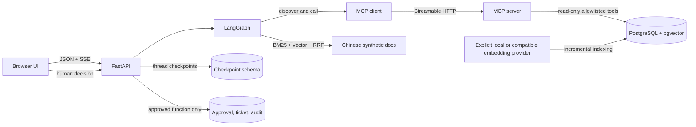
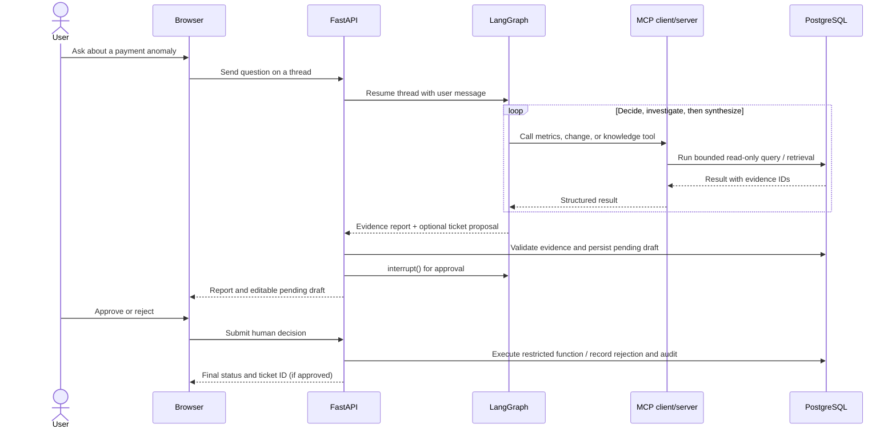

# CaseFlow Agent

CaseFlow is a local payment-incident investigation demo: a LangGraph agent queries synthetic PostgreSQL data and Chinese operations documents through MCP, writes an evidence-linked report, and can propose a support ticket that waits for human approval before a restricted database function creates it.

> **V1-D engineering acceptance — 2026-11-11.** Core functionality was exercised locally against synthetic PostgreSQL 17.11 data, Docker Compose, the browser UI, and a zero-price Live model route. This is a portfolio demo, not a production payment system. See the [acceptance record](docs/V1D_ACCEPTANCE_2026-11-11.md) for measured results and limitations.

## What it demonstrates

- LangGraph tool-use loop with an independent Streamable HTTP MCP server.
- Read-only PostgreSQL metrics/change tools and Chinese BM25 + pgvector retrieval, fused with Reciprocal Rank Fusion (RRF).
- Persistent conversation/checkpoint recovery, API reports, citations, tool traces, and SSE progress events.
- Agent-proposed, evidence-bound ticket drafts; the UI can edit, approve, or reject them. Only an explicitly approved draft can reach the function-only action executor.
- Offline mode, a local CPU embedding option, a small real-model Live path, Docker Compose, and a bounded eight-case pytest suite.

## Architecture



## Investigation and approval flow



The Agent can propose an action but cannot approve it. The server verifies evidence IDs against the investigation, binds the draft to a payload hash, and resumes the interrupted graph only after a human decision. The action role has execute permission on narrow database functions and no direct table-write permission. Metric, change, and knowledge access remains read-only; the project exposes no arbitrary SQL tool and does not change payment records.

## Stack

Python 3.13, FastAPI, LangGraph, LangChain MCP Adapter, MCP Streamable HTTP, PostgreSQL 17, pgvector, SQLAlchemy, BM25, FastEmbed (`BAAI/bge-small-zh-v1.5`, 512 dimensions), server-rendered HTML/JavaScript, SSE, Docker Compose, pytest, Ruff, GitHub Actions.

## Local run (Windows / PowerShell)

Use the existing project environment. Review `.env.example` and keep `.env` local; never commit credentials. For an existing database, back up first and apply reviewed incremental migrations without deleting Docker volumes.

```powershell
if (-not (Test-Path .env)) { Copy-Item .env.example .env }
New-Item -ItemType Directory -Force .tmp | Out-Null
$env:TEMP = (Resolve-Path .tmp).Path
$env:TMP = $env:TEMP
.\.venv\Scripts\python.exe -m pip install -e "[dev,local-embedding]"
docker compose up -d postgres
.\scripts\apply_v1c_migration.ps1 -Database caseflow_test
.\scripts\apply_v1c_migration.ps1 -Database caseflow
.\scripts\apply_v1d_migration.ps1 -Database caseflow_test
.\scripts\apply_v1d_migration.ps1 -Database caseflow
.\.venv\Scripts\python.exe scripts\setup_checkpoint_db.py
.\.venv\Scripts\python.exe scripts\setup_checkpoint_db.py --test
docker compose up -d --build mcp api
```

The compose API and MCP ports bind to loopback (defaults `8000` and `8001`; local `.env` can override them). Visit `http://127.0.0.1:8000`. Offline mode requires no model key. To explicitly enable local embeddings, configure `EMBEDDING_PROVIDER=fastembed`, model, dimensions, and cache settings, then run `python scripts/index_embeddings.py --database test` or `--database development`. The index command is incremental and database selection is explicit. External embedding API indexing requires the additional `--confirm-embedding-api` flag. Do not expose this unauthenticated demo to a public network.

## Verified results

- Existing synthetic databases retain 49,600 payment attempts, 18 documents, 7 changes, and 4 incidents. Target window: Beijing 22/50 failed; seven-window baseline 10/330.
- A genuine local CPU BGE model indexed 18/18 chunks in both test and development databases. A repeated development index run indexed zero chunks. `EXPLAIN` for the 512-dimensional query selected its model/dimension-specific HNSW index.
- Nine labeled synthetic retrieval queries were measured at `k=5`. Hybrid improved validation Recall@5 over BM25 (0.833 vs 0.667), but validation MRR and nDCG were lower; the small set is not broadly representative. Full split metrics are in the [acceptance record](docs/V1D_ACCEPTANCE_2026-11-11.md).
- The Live investigation used three successful calls on `nvidia/nemotron-3.5-super-vl:free` (verified zero prompt/completion price and no provider fallback), 6,506 input and 2,433 output tokens, and 17.8 seconds. It used MCP for metrics → changes → knowledge, returned the 22/50 and 10/330 measurements, and produced four validated citations. A human approved the generated synthetic ticket; one ticket and audit trail were created. The model's causal hypotheses were explicitly ungraded and treated as hypotheses.
- A separate offline Compose UI investigation confirmed the container API calls the MCP service and PostgreSQL. The thread/report restored after API container rebuild; an in-process browser refresh restored its saved trace without duplicate activity entries.
- Exactly 8 pytest cases were collected and passed; Ruff, standalone MCP smoke, V1-C integration smoke, and V1-D end-to-end approval/checkpoint smoke passed locally. GitHub Actions is configured to run Ruff and pytest on pull requests and pushes to `main`.

## Reproduce and discuss

```powershell
ruff check src scripts tests
.\.venv\Scripts\python.exe -m pytest --collect-only -q
.\.venv\Scripts\python.exe -m pytest -q
.\.venv\Scripts\python.exe scripts\mcp_smoke.py
.\.venv\Scripts\python.exe scripts\v1d_smoke.py
```

The V1-D smoke uses synthetic test data and cleans only its uniquely tagged test artifacts. The browser walkthrough and expected evidence are in [V1-D demo guide](docs/V1D_DEMO.md); architecture and interview talking points are in the [technical interview guide](docs/TECHNICAL_INTERVIEW_GUIDE.md).

## Limits

- Only nine synthetic retrieval queries are labeled. Hybrid is not uniformly better than BM25, and there is no reranker.
- The Live model's citation identifiers and quoted text were checked; semantic entailment of its hypotheses is not fully graded. Time correlation does not establish that a change caused an incident.
- The local model is a small CPU embedding model; retrieval results are suitable for this demo corpus, not evidence of production search quality.
- The app has no authentication or multi-user isolation. SSE's short event journal is process-local; the latest report, thread history, and checkpoint state survive API restart.
- Dataset and ticket are synthetic. The project cannot refund, route, roll back, or write payment records.
